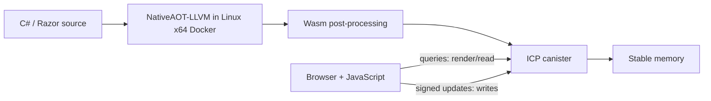

# wasp-dotnet

> **IMPORTANT :** The complete **Bzzz (Bzz)** application is in [`bzzz/`](bzzz/README.md).
> `aot/samples/BlazorWasp/` is a separate framework demo, not the full application.
> Bzzz has its own framework copies; changes in the root SDK do not propagate
> automatically. Existing production canisters hold user data: preserve their
> stable-memory layout and use a reviewed **upgrade**, never a reinstall.

**C# / .NET 10 applications compiled to Internet Computer canisters, plus the
Bzzz social application built on that stack.** This is an alpha source repository:
framework libraries, examples, application code, and research are kept together.

New contributor? Read [Getting started](CONTRIBUTING.md), then
[Architecture](docs/ARCHITECTURE.md). For the social application, go directly to
[Bzzz](bzzz/README.md). The [documentation index](docs/README.md) distinguishes
current guides from historical reports and proposals.

## What is in this repository?

| Area | Purpose | Start here |
| --- | --- | --- |
| `aot/Wasp.*` | CDK (canister development kit), HTTP, ASP.NET Core adapters, Razor rendering, persistence | [Architecture](docs/ARCHITECTURE.md) |
| `aot/samples/` | Small examples, framework integration demos, and diagnostic reproductions | [Sample map](#samples-and-experiments) |
| `bzzz/` | **Bzzz** (also called Bzz): chat, servers/channels, forums, social feed, direct messages | [Application guide](bzzz/README.md) |
| `shared/tools/` | Wasm export rewriting, WASI stubs, and framework DLL rewriting | [Build pipeline](docs/ARCHITECTURE.md#build-pipeline) |
| `runtime/` | Experimental Mono/.NET runtime hosting inside a canister | [Research status](runtime/README.md) |
| `docs/` | Architecture, validation, historical design records, and future plans | [Index](docs/README.md) |

### Two `BlazorWasp` projects: choose the correct one

- **`bzzz/aot/samples/BlazorWasp/` is Bzzz.** It contains the social services,
  forum/feed pages, private messages, and browser-side vetKD encryption.
- **`aot/samples/BlazorWasp/` is the framework demonstration.** It retains the
  base shell, simple chat, and embedded Tetris/CRM browser applications after
  Bzzz was extracted. It is not the full social application.

Bzzz includes its own copies of the Wasp framework and build tools. It is a
regular tracked directory in this repository, not a Git submodule. Updating
`aot/Wasp.*` does **not** update `bzzz/aot/Wasp.*`; review and port shared fixes
explicitly. Bzzz retains the assembly name `BlazorWasp` for its existing build
and canister exports.

## How it works



The AOT path compiles application code ahead of time into WebAssembly. The IC
hosts that module as a canister. `Wasp.AspNetCore` adapts IC HTTP entrypoints to
an ASP.NET Core pipeline; the Wasp Razor renderer returns HTML from queries and
handles events through updates. Bzzz stores its data in stable memory rather
than an external SQL database.

ASP.NET Core and Razor adapters **are implemented in `aot/`**. This does not
mean every ASP.NET Core feature works unchanged: filesystem, sockets, threading,
cryptography, reflection, and asynchronous I/O have specific restrictions. Read
[unsupported/substituted APIs](aot/Wasp.AspNetCore/UNSUPPORTED.md).
`Wasp.OrthogonalPersistence` is a small DbContext-style persistence library,
**not Microsoft Entity Framework Core**.

The separate `runtime/` experiment tries to host the Mono runtime instead of
AOT-compiling the application. Its recorded boot blockers remain documented;
it is not the recommended onboarding route or a proven full-.NET alternative.

## First local build

Requirements: Docker with Linux x64 support, Rust/Cargo, `wasm-tools`, `ic-wasm`,
and `dfx` for local deployment. Host .NET 10 is needed for unit tests and browser
WASM sub-apps; Binaryen's `wasm-opt` is also needed for Bzzz.
See [tool setup and versions](CONTRIBUTING.md#toolchain).

From the repository root:

```bash
docker build --platform linux/amd64 -t wasp-dotnet-build:latest \
  -f aot/docker/Dockerfile.build aot/docker
cargo build --release --manifest-path shared/tools/wasi-stub/Cargo.toml

# Compile, rewrite, validate, and size-check HelloWorld; no deployment.
SAMPLES=HelloWorld bash .github/workflows/build-canisters.sh
```

Then, for a **new local** canister:

```bash
cd aot
dfx start --background
dfx canister create hello
dfx canister install hello --mode install \
  --wasm samples/HelloWorld/HelloWorld.canister.wasm
dfx canister call hello hello
```

The source returns `("Hello from C# compiled to wasm by .NET 10")`.
Use `--mode upgrade` for later installs when retaining state. The older
HelloWorld `build-and-deploy.sh` uses `reinstall`; do not use that script on a
canister whose data you need to keep.

For Bzzz's build and first local install, follow [its own guide](bzzz/README.md#build-and-run-locally).
Its build script builds only by default. Do not confuse the sample deployment
configuration in `aot/` with the Bzzz configuration in `bzzz/aot/`.

## Samples and experiments

All paths below are under [`aot/samples/`](aot/samples/).

| Sample(s) | What to learn |
| --- | --- |
| `HelloWorld`, `Counter` | Candid entrypoints, queries/updates, stable state |
| `HelloWeb`, `HelloFetch` | HTTP responses and callback-based HTTPS outcalls |
| `HelloChat`, `BlazorChat` | WebSocket CDK and a separate browser WASM frontend |
| `AspNetCoreHello`, `AspNetCoreEndpoints`, `AspNetCoreApi` | ASP.NET Core canister hosting and routing |
| `RazorOnIc`, `BlazorVanilla`, `WebApiVanilla`, `MvcVanilla` | Razor, Blazor, Web API, and MVC adaptation examples |
| `CircuitOnIc` | Blazor Server circuit/transport experiment; distinct from Wasp render-as-query |
| `BlazorWasp`, `TetrisWasm`, `CrmWasm` | Framework demo host and embedded browser sub-apps |
| `TodoEf` | Wasp's own stable-memory persistence API despite the historical name |
| `VetkdCsharpPoc` | Host-side C# vetKD test-vector reproduction |
| `Issue80Repro`, `_AspNetSmoke` | Diagnostic/compiler reproductions; retain for regression work |

[`aot/templates/`](aot/templates/) contains starter projects. Inspect their
project references before copying them outside this source tree.

## Validation and current limits

The repository has four host-side xUnit projects, a JavaScript decoder
cross-check, and a local-canister HTTP acceptance harness. The current GitHub
workflow builds five basic AOT canisters and publishes `BlazorChat`; it does
**not** automatically validate Bzzz, all host tests, or the runtime experiment.

On **2026-11-06**, the four host suites produced **147 passed, 1 failed, 0 skipped**.
The failing router test and exact reproduction commands are in
[Testing](docs/TESTING.md). These results do not establish an end-to-end Bzzz
build, a live deployment, or a browser acceptance result.

Before changing persisted structures or deploying an existing canister, read
[Bzzz's persistence/deployment notes](bzzz/README.md#persistence-and-upgrades).
`aot/canister_ids.json` and `bzzz/aot/canister_ids.json` contain existing mainnet
IDs; they are not an instruction to deploy to those targets.

## Documentation and contribution

- [Getting started and contribution workflow](CONTRIBUTING.md)
- [Architecture and source map](docs/ARCHITECTURE.md)
- [Bzzz application, security boundaries, and local setup](bzzz/README.md)
- [Tests and known gaps](docs/TESTING.md)
- [Documentation index and historical records](docs/README.md)
- [Repository cleanup record](docs/MAINTENANCE.md)

Project work is tracked in [GitHub issues](https://github.com/miadey/wasp-dotnet/issues).
Use the source and current guides to assess implemented features; old milestone
notes are retained as history.

## License and upstream projects

[MIT](LICENSE), copyright 2026 miadey. The stack uses .NET/NativeAOT-LLVM, the
DFINITY SDK, Bytecode Alliance wasm-tools, Binaryen, and Walrus. Vendored framework
assemblies and JavaScript dependencies retain their upstream licensing terms.
