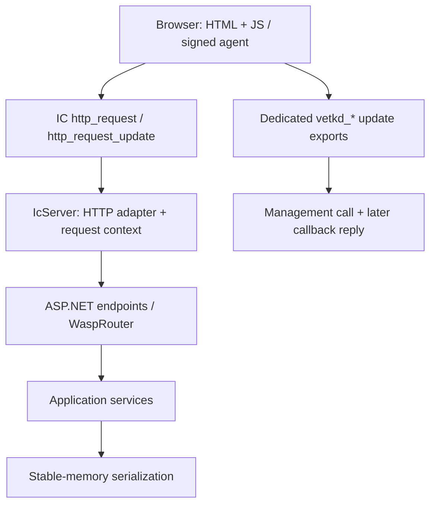

# Architecture and source map

This guide describes the checked-in AOT/Bzzz implementation. It does not certify
the currently deployed module. For setup see [Contributing](../CONTRIBUTING.md);
for experiments see [runtime](../runtime/README.md).

## Execution model

A canister is a WebAssembly program with IC entrypoints. A **query** reads state
without committing mutations; an **update** changes state through replicated
execution. The application distinguishes cheap read/render paths from writes.
Stable memory is accessed through IC imports and is the durable storage used by
the services; upgrades and reinstalls have different effects on that data.

## Framework layers

| Component | Role and useful entrypoint |
| --- | --- |
| [Wasp.IcCdk](../aot/Wasp.IcCdk/) | `Ic0` imports, `MessageContext`, Candid encoding, replies, stable-memory primitives |
| [Wasp.IcCdk.SourceGenerator](../aot/Wasp.IcCdk.SourceGenerator/) | Attribute-based canister exports for examples that use generated entrypoints |
| [Wasp.Http](../aot/Wasp.Http/) | IC HTTP request/response records and Candid handling |
| [Wasp.Outcalls](../aot/Wasp.Outcalls/) | Callback-based HTTPS outcalls, distinct from ordinary socket HTTP |
| [Wasp.WebSockets](../aot/Wasp.WebSockets/) | IC WebSocket protocol helpers, principals, hashing, certification trees |
| [Wasp.AspNetCore](../aot/Wasp.AspNetCore/) | `IcServer`, hosting extensions, static assets, certification, `IcSyncContext` |
| [Wasp.AspNetCore.Blazor.Wasp](../aot/Wasp.AspNetCore.Blazor.Wasp/) | `WaspRouter`, HTML renderer, render/query and event/update endpoints |
| [Wasp.AspNetCore.Blazor.Server](../aot/Wasp.AspNetCore.Blazor.Server/) | Separate circuit, MessagePack, and transport integration used by circuit experiments |
| [Wasp.OrthogonalPersistence](../aot/Wasp.OrthogonalPersistence/README.md) | DbContext-like API with stable-memory snapshots; not EF Core |

[Bzzz](../bzzz/README.md) carries copies of the libraries it needs. Its domain
services serialize their own fixed stable-memory regions; do not assume that
they use `Wasp.OrthogonalPersistence` or its snapshot layout.

### ASP.NET and async boundaries

`IcServer` maps a canister request into ASP.NET features; it does not open a
Kestrel socket. `IcSyncContext` pumps continuations within one IC message.
An await that depends on a response in a later IC message cannot be treated as
ordinary in-process async HTTP. Bzzz's vetKD code therefore exposes dedicated
Candid methods and reply/reject callbacks outside the ASP.NET pipeline.

### Rendering and authentication

`WaspRouter` resolves a page to a Razor component, supplies route/query context,
and renders HTML. `/_wasp/render` returns a batch for the client; `/_wasp/event`
dispatches a component event and renders again. Bzzz also has explicit `/api/*`
endpoints, page shells, and JavaScript in its application `Program.cs`.

State-changing and sensitive application operations must use authenticated
caller information from the signed IC call. Display-name bindings and request
headers supplied by a browser are not a substitute for `msg_caller` checks.

`IcResponseCertV2` and `IcCertifiedAssets` support certified static assets. Some
dynamic endpoints deliberately register pass-through certification expressions;
their response bodies are not thereby certified. Do not equate a canonical
`icp0.io` URL with body certification for every dynamic route.

## Build pipeline

1. The Docker image supplies Linux x64 .NET and WASI SDK tooling. Application
   projects use `wasm32-wasi`, NativeAOT-LLVM, trimming, and feature switches.
2. `Wasp.AspNetCore.targets` supplies framework references and linker
   substitutions. `Vendor/*.dll` are rewritten framework assemblies used to
   work around compiler/framework assumptions; they are required inputs.
3. `shared/tools/icp-publish/icp-publish.sh` rewrites export names such as
   `canister_query__hello` to IC names and shrinks the module using host tools.
4. `shared/tools/wasi-stub` rewrites unsupported WASI imports. A stub is not a
   full implementation of a filesystem, OS randomness, threads, or sockets.
5. Bzzz and several advanced samples additionally run `wasm-opt`.
6. The resulting `.canister.wasm` is installed explicitly with `dfx` when
   deployment is requested. `dfx.json` entries use `build: []`; a plain deployment
   command is not a replacement for the compilation pipeline.

The basic CI builder mounts `aot/` into its container; the Bzzz builder mounts
`bzzz/` and uses that tree's own helpers. Preserve these distinctions when
adapting scripts. See [Tests](TESTING.md) for exactly what CI covers.

## Extension points

| Change | Read/edit first |
| --- | --- |
| New Bzzz page | Its `Components/Pages/`, route/shell registration in `Program.cs` |
| New Bzzz operation | Endpoint caller checks, domain service, serializer, browser call |
| Shared framework behavior | Root library and host tests, then review the Bzzz copy |
| Storage format | Service offset/header/version, reader/writer, upgrade compatibility |
| New canister export | Source generator or manual export, project assembly roots, `.did`, export rewriting |
| Compiler/framework upgrade | Preview package versions, Vendor weavers, substitutions, compiler reproductions |

## Boundaries and unresolved work

- The repository is alpha. The presence of a demo does not imply general
  compatibility with every feature of the corresponding .NET framework.
- [Unsupported APIs](../aot/Wasp.AspNetCore/UNSUPPORTED.md) documents substitutions
  and restrictions. Do not rely on native randomness, sockets, or dynamic IL
  generation becoming available because compilation succeeds.
- The Wasp router's normalization test currently disagrees with its BatchId
  hashing behavior; see the dated baseline in [Testing](TESTING.md).
- The independent Mono hosting experiment retains boot blockers. It is not the
  backend used by Bzzz and is not a proven route to unrestricted reflection.
- Historical documentation contains measurements and platform limits from its
  original experiments; recheck them for the target environment before release.
